# Gesture-Controlled Presentation System

Control a Google Slides presentation without touching your keyboard. This project uses your webcam and MediaPipe hand tracking to recognize hand signs and swipes, then sends slide-control keyboard input to the presentation. Choose between a Python desktop application and a Chrome extension.

## Features

- Recognizes ten hand signs to jump directly to slides 1–10.
- Starts a slideshow when both hands show an open palm; exits with a left-hand fist.
- Navigates forward and backward with a horizontal right-index-finger swipe.
- Waits for a gesture to remain steady before acting, helping prevent accidental commands.
- Runs hand detection locally on your computer; camera frames are not sent to a server.
- Supports two ways to use the project: Python with OpenCV, or a Chrome extension for Google Slides.
- Includes a live camera preview and hand/gesture diagnostics in the Python app, and camera status in the extension.

## Gesture Guide

Finger patterns are shown in **thumb, index, middle, ring, pinky** order. Slide and exit signs use the **physical left hand**; swipe with the **physical right index finger**.

<table>
  <tr>
    <td align="center">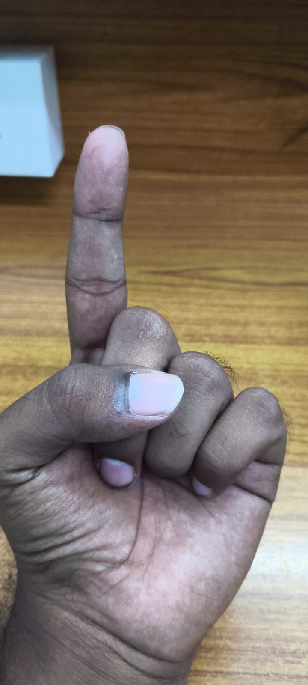<br><b>Slide 1</b><br>Index finger</td>
    <td align="center">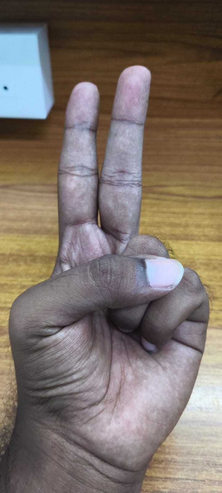<br><b>Slide 2</b><br>Index + middle</td>
    <td align="center">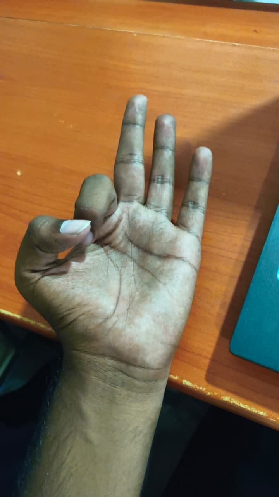<br><b>Slide 3</b><br>Three fingers; thumb across palm</td>
    <td align="center">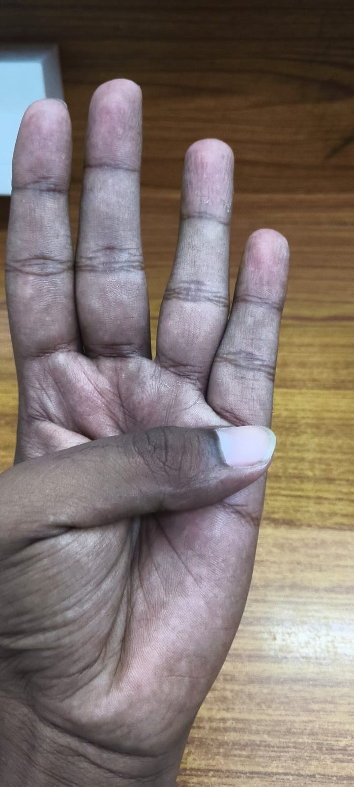<br><b>Slide 4</b><br>Four fingers</td>
    <td align="center">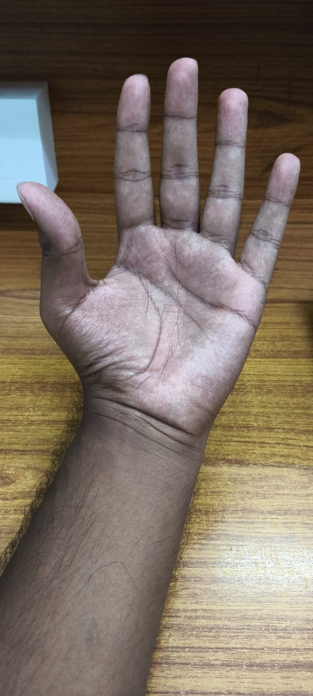<br><b>Slide 5</b><br>Open palm</td>
  </tr>
  <tr>
    <td align="center">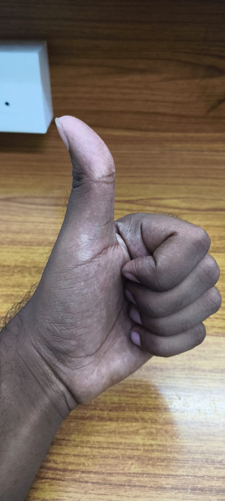<br><b>Slide 6</b><br>Thumb only</td>
    <td align="center">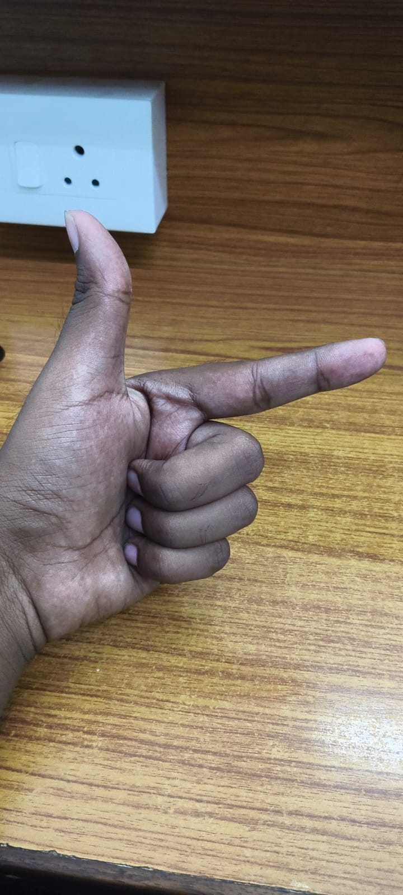<br><b>Slide 7</b><br>Thumb + index</td>
    <td align="center">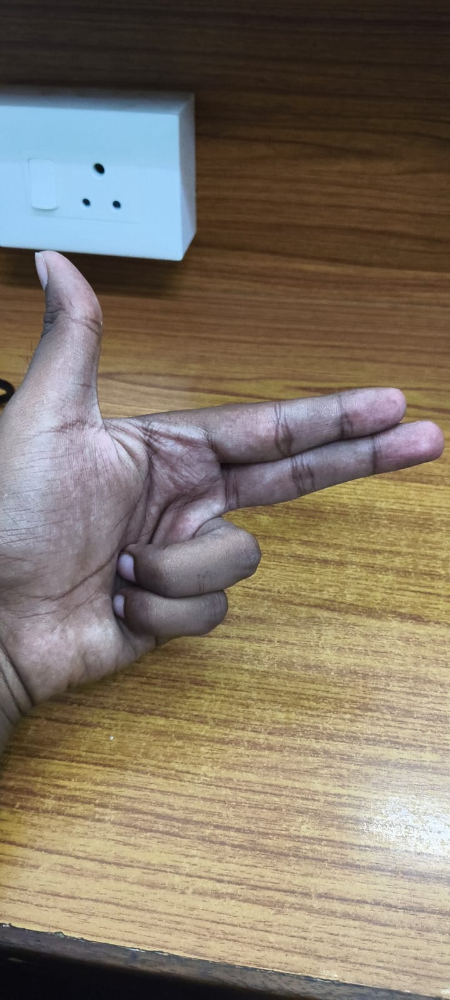<br><b>Slide 8</b><br>Thumb + index + middle</td>
    <td align="center">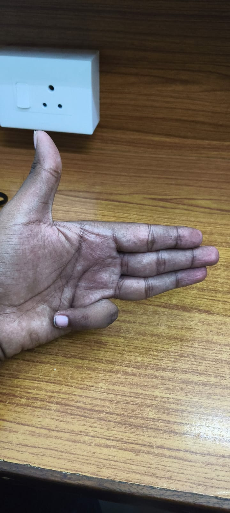<br><b>Slide 9</b><br>Thumb + four fingers</td>
    <td align="center">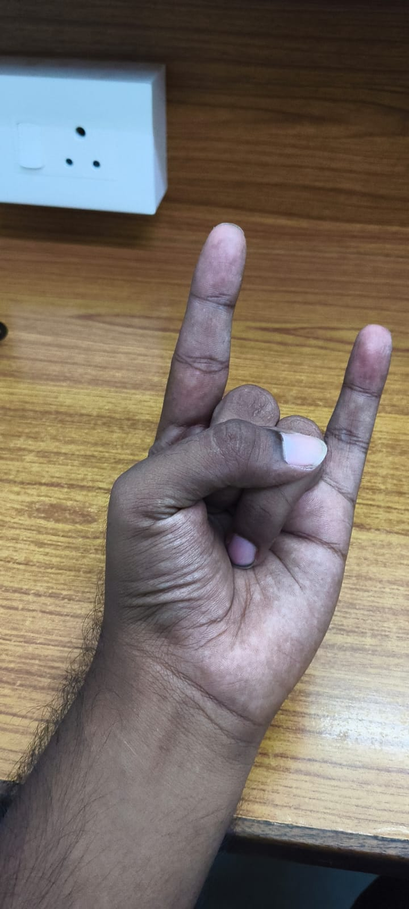<br><b>Slide 10</b><br>Index + pinky</td>
  </tr>
</table>

Slide 3 and slide 9 have similar detected finger patterns; the thumb direction distinguishes them. The slide 3 image above shows the replacement sign in `images/new_3.jpeg`.

### Other controls

| Action | Gesture |
| --- | --- |
| Start slideshow | Show an open palm with both hands |
| Exit slideshow | Close the left hand into a fist |
| Previous slide | Swipe the right index finger to the left |
| Next slide | Swipe the right index finger to the right |

Hold a sign steady for about **0.7 seconds**. To trigger the same sign again, lower your hand or make an unrecognized pose for about **0.7 seconds** first. A swipe triggers once; let the right hand settle before swiping again.

## How It Works

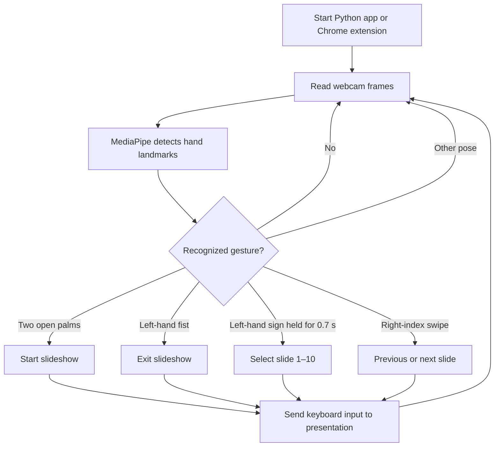

The Python app processes frames with OpenCV and MediaPipe Tasks. The Chrome extension runs MediaPipe in a local offscreen document, then uses its service worker to send trusted keyboard input to the Google Slides tab. In both versions, camera processing remains on the device.

## Tech Stack

| Component | Technologies |
| --- | --- |
| Hand tracking | MediaPipe Hand Landmarker / MediaPipe Tasks Vision |
| Desktop application | Python, OpenCV, `pyautogui` |
| Browser application | JavaScript, Chrome Extension Manifest V3 |
| Browser build | Node.js, npm, Vite |
| Browser vision package | `@mediapipe/tasks-vision` |
| Gesture recognition | Hand landmarks, finger-pose classification, gesture hold timing, swipe detection |
| Presentation control | Keyboard input to Google Slides |

## Requirements

### Python desktop application

- Python 3.12 (the tested setup shown below)
- A webcam
- A presentation open and focused on screen

### Chrome extension

- Google Chrome 116 or later
- Node.js and npm
- A Google Slides presentation open in Chrome
- A webcam

## Run the Python Application

From the project root in PowerShell:

```powershell
py -3.12 -m venv .venv
.\.venv\Scripts\python.exe -m pip install -r requirements.txt
.\.venv\Scripts\python.exe setup_models.py
.\.venv\Scripts\python.exe main.py
```

The first model setup downloads the MediaPipe hand-landmarker model and verifies its SHA-256 checksum. The camera preview displays recognized hand patterns and hand identity. Press **q** while the preview is focused to quit. Keep the presentation window focused when using the desktop version.

## Install the Chrome Extension

1. Build the extension:

   ```powershell
   cd extension
   npm install
   npm run build
   ```

2. In Chrome, open `chrome://extensions` and enable **Developer mode**.
3. Choose **Load unpacked** and select the project's `extension\dist` folder.
4. Open a Google Slides presentation and select the extension icon.
5. Allow camera access, then select **Start camera**. Return to the presentation and use the gestures above. The popup can be closed while the camera runs in the background.

Chrome may show a debugger permission warning. The extension uses the debugger permission to send trusted keyboard input so Google Slides responds to slide-control gestures. Its MediaPipe JavaScript, WebAssembly runtime, and hand-landmarker model are packaged locally rather than loaded from a CDN. Reopen the extension popup and select **Stop camera** to stop capture.

## Tests

Run the Python gesture-navigation tests from the project root:

```powershell
py -3.12 -m unittest discover -s tests
```

Run the Chrome extension gesture tests:

```powershell
cd extension
npm test
```

## Privacy and Permissions

Camera frames are processed locally by MediaPipe and are not uploaded by this application. The Python app needs webcam access and uses `pyautogui` to send presentation keyboard input. The Chrome extension requests camera access and the browser permissions needed to communicate with the Google Slides tab and send trusted keyboard input. Start the camera only when you intend to use gesture control.

## Project Structure

```text
.
├── main.py                  # Python/OpenCV desktop application
├── setup_models.py          # Downloads and verifies the Python hand model
├── swipe_navigation.py      # Shared Python swipe and hand-side helpers
├── requirements.txt         # Python dependencies
├── models/                  # Hand-landmarker model location
├── images/                  # Gesture reference photos
├── tests/                   # Python tests
└── extension/
    ├── public/              # Extension pages, manifest, and local assets
    ├── src/                 # Gesture detection and extension UI
    ├── tests/               # JavaScript gesture tests
    └── package.json         # npm scripts and dependencies
```

## Applications

- Touch-free presentation control
- Human-computer interaction demonstrations
- Computer-vision and AI education
- Accessibility-focused interaction experiments

